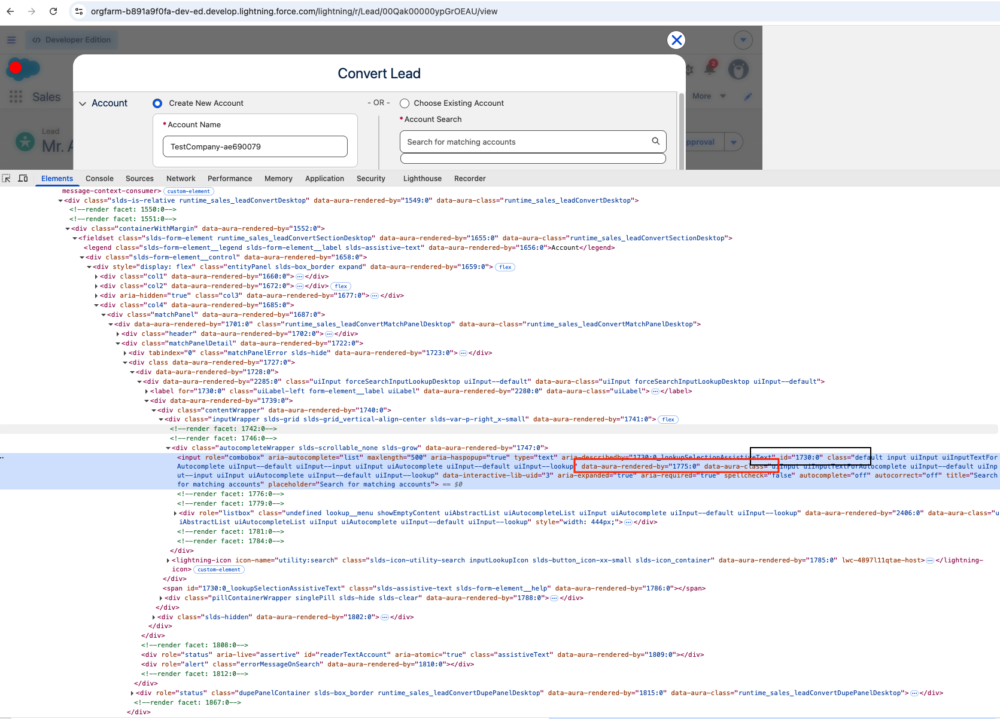
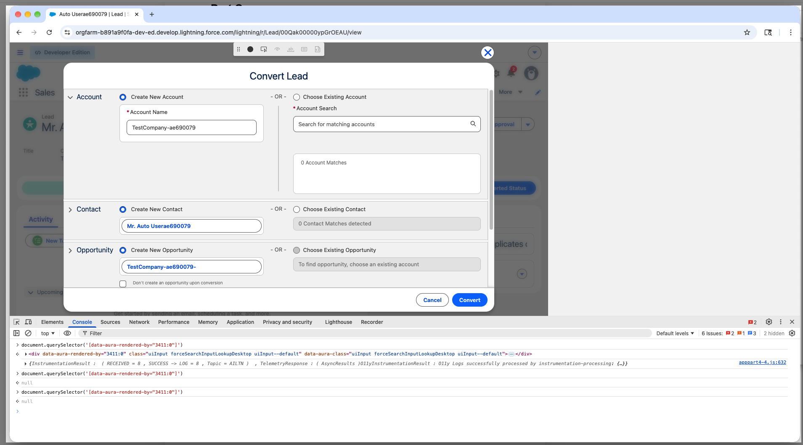

# Salesforce Lead Automation

Playwright and TypeScript end-to-end tests for Salesforce Lightning. The suite covers Salesforce authentication, lead creation and management, lead conversion, and negative lead-validation scenarios. It also includes unit-style tests for login and verification-code helpers.

## Project structure

```text
.
├── pages/                 # Page objects for Salesforce pages
├── tests/                 # Playwright tests
├── utils/                 # Login, verification, and test-data helpers
├── storage/               # Generated Playwright authentication state (git-ignored)
├── playwright.config.ts
├── package.json
└── .env.example
```

## Getting started

### Prerequisites

- Node.js and npm
- Access to a Salesforce org
- Mailosaur credentials if Salesforce requires email verification during login

### Install and configure

1. Install the dependencies and Playwright browsers:

   ```bash
   npm install
   npx playwright install
   ```

2. Copy the environment template and edit `.env`:

   ```bash
   cp .env.example .env
   ```

   Set the Salesforce home and login URLs in `.env`, along with the Salesforce username and password. For example:

   ```dotenv
   SALESFORCE_HOME_URL=https://<your-salesforce-org>/lightning/page/home
   SALESFORCE_LOGIN_URL=https://<your-salesforce-org>/
   SALESFORCE_USERNAME=your_username
   SALESFORCE_PASSWORD=your_password
   ```

   If login requires email verification, also set `MAILOSAUR_API_KEY`, `MAILOSAUR_SERVER_ID`, and `MAILOSAUR_INBOX_ID` from `.env.example`. The saved session is stored at `storage/storageState.json`.

3. Create or refresh the saved Salesforce session. Run the login test by itself with one worker:

   ```bash
   npx playwright test tests/Login.spec.ts --project=chromium --workers=1
   ```

   The test logs in as needed and saves the authenticated browser state for the other Salesforce UI tests. Keep the saved state private; it contains session credentials.

## Run tests

Run **all tests in `tests/`** with one worker:

```bash
npx playwright test tests --workers=1
```

The login flow does not work reliably with multiple workers, so retain `--workers=1` when running the full suite or `Login.spec.ts`. The configured browser projects are Chromium, Firefox, and WebKit; Playwright runs the suite in each project by default.

Run an individual test file:

```bash
npx playwright test tests/Login.spec.ts --project=chromium --workers=1
npx playwright test tests/loginHelper.spec.ts
npx playwright test tests/LeadCreationAndManagement.spec.ts
npx playwright test tests/LeadConvert.spec.ts
npx playwright test tests/NegativeScenarios.spec.ts
```

Open the HTML report after a run:

```bash
npx playwright show-report
```

## Test coverage

- **`Login.spec.ts`** — authenticates to Salesforce, checks the saved session state, and verifies that the Home page loads.
- **`loginHelper.spec.ts`** — tests verification-code extraction, Mailosaur authentication headers, and authenticated-session detection.
- **`LeadCreationAndManagement.spec.ts`** — creates a lead, checks its details and record ID, then updates its status.
- **`LeadConvert.spec.ts`** — creates and converts a lead, selecting existing Salesforce records when available.
- **`NegativeScenarios.spec.ts`** — checks required-field validation and duplicate lead handling.

The Salesforce UI tests use page objects in `pages/`. Test data is generated in `utils/dataGenerator.ts`. Salesforce UI changes, org configuration, or duplicate-detection rules may require corresponding test updates.

## Shadow DOM / Dynamic Component Evidence

### Salesforce Lead Conversion — Existing Account Search

During lead conversion in the Salesforce org used for this submission, the Existing Account Search input is rendered inside a Salesforce Aura component. Its `data-aura-rendered-by` value is generated at runtime, so a selector based on a captured value can stop matching after the component is re-rendered; the DevTools screenshots below show the generated attribute and the failed repeated query.

**Naive locator:**

```ts
page.locator('[data-aura-rendered-by="3411:0"]');
```

**Locator used in the test** ([`tests/LeadConvert.spec.ts`](tests/LeadConvert.spec.ts)):

```ts
page.getByRole('combobox', { name: 'Account Search' });
```

This locator uses the input's semantic role and visible accessible name rather than Salesforce's transient Aura identifier. Those user-facing attributes are meaningful and are less likely to change when Salesforce regenerates the component's internal DOM.

**DevTools DOM evidence:**



**Failed query evidence:**



**Org recording:** [View the Lead Conversion dynamic DOM recording](evidence/partc-dynamic-dom-recording.mov)
